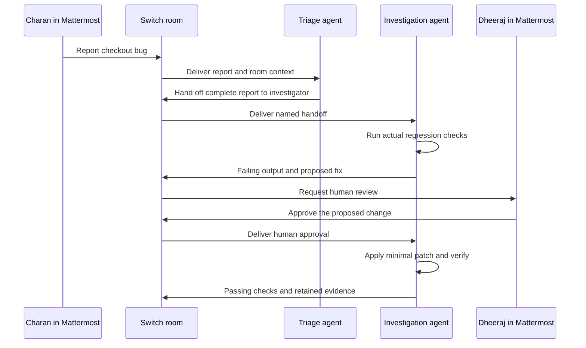

# Checkout Rescue

**A bug report in team chat becomes a reproduced failure, a human-reviewed fix,
and a verified result—with the whole handoff running through Switch.**

Built by [Dheeraj M G](https://github.com/DheerajMG-Bng) and
[Charan Arangi](https://github.com/ACT2039), team Hanuman, for the Flip the Switch
Hackathon. Primary track: Best Business Workflow.

## The problem

A checkout bug often gets copied from chat to a coding assistant, then back to
chat without the inputs, failing command, or review decision. Checkout Rescue
keeps the people and agents in one Mattermost thread and retains actual command
output, code hashes, and the review record in a local incident file.

The demonstration uses a **deliberately seeded bug and synthetic data**. A
10% coupon is applied twice: a ₹1,000 cart becomes ₹810 instead of ₹900. No
production customer or payment system is connected.

## What runs where



**Switch is the collaboration layer:** it connects the two independently running
agents to Mattermost, delivers named handoffs and human messages, and maintains
their shared room context. The local checkout scripts can be tested without
Switch; the team-in-chat workflow requires Switch.

## Requirements

- Node.js 22 or newer and Git.
- Switch Console with a healthy local server and a signed-in agent provider.
- Mattermost connected to Switch. Docker is used by this laptop's bundled
  Mattermost setup; Switch core itself runs as a native local process.
- Two people with Mattermost accounts. Both may use separate browser profiles
  on one laptop.

No third-party Node packages, API keys, database, or hosted app are needed for the
checkout example. Agent usage uses your own provider account.

## Run the code

```sh
git clone https://github.com/DheerajMG-Bng/checkout-rescue.git
cd checkout-rescue
npm test
npm run demo
```

If PowerShell blocks `npm.ps1`, use `npm.cmd` instead. The CLI can also be invoked
directly with `node scripts/rescue.mjs`.

## Connect the workflow through Switch

1. Follow the [Switch quickstart](https://docs.switchagents.ai/switch-rooms/getting-started)
   and connect Mattermost. Send one message to switch-buddy to verify the provider.
2. Open **Templates** in Switch Console and load
   [`switch/checkout-rescue.template.yaml`](switch/checkout-rescue.template.yaml).
3. Choose the provider installed and signed in on your machine. Select Mattermost.
4. Set `reporter` and `reviewer` to your actual Mattermost usernames, without `@`.
   This team's defaults are `charantej` and `dheerajmg`.
5. Run the template. It creates `checkout-triager`, `checkout-investigator`, and
   a `checkout-rescue` room containing both agents and both people. Agents use
   independent working directories and the public repository.
6. Open the corresponding Mattermost channel. The triager introduces itself and
   waits for a real report. Use [the demo steps](docs/DEMO.md).

The template adapts Switch's triage-pair example, then adds a specific task,
human roles, an explicit review sequence, a disposable code lab, and real output
verification. See [attribution and upstream terms](THIRD_PARTY.md).

## Incident commands

Run these in the investigation agent's repository, not the triager's copy:

```sh
node scripts/rescue.mjs start
node scripts/rescue.mjs reproduce
```

`reproduce` intentionally exits with code **1** when the seeded regression is
found. Its output includes `expected=90000 actual=81000 paise`; this is a real
process result, not a scripted chat response. The lab remains awaiting review.

After a human approves the proposed fix in the chat thread, record the actual
review and its text or message link:

```sh
node scripts/rescue.mjs approve --by @dheerajmg --message "<actual approval text or link>"
```

The investigation agent then edits `lab/checkout.mjs` and runs:

```sh
node scripts/rescue.mjs verify
npm test
```

The final verification must show `6/6 checks passed` and a different code hash.
The CLI does not contain a command that automatically applies the fix. Agents
must perform the code change. Existing incidents are never silently reset;
set `RESCUE_HOME` to a fresh folder for another independent run.

## Evidence and optional local viewer

- `lab/incident.json`: incident state, events, timestamps, and review record.
- `evidence/latest.json`: real command output, exit codes, and SHA-256 code hashes.
- `npm start`: read-only viewer at `http://127.0.0.1:4173` for the current local lab.

The viewer must read the investigation agent's lab to show its work. Start it
from that agent's repository, or set `RESCUE_HOME` to that repository's absolute
path before starting it. It does not send chat messages or replace Switch.

Evidence files are ignored by Git by default. Publish only a reviewed example
without credentials, private chat, or unrelated local paths.

## Code and tests

The checkout uses integer paise, validates quantities and discounts, applies the
discount once, rounds at order level, taxes discounted goods, and uses the
pre-discount subtotal for free shipping. These are explicit demo business rules,
not a tax or payment integration.

`npm test` runs checkout calculations and incident transitions. The workflow
tests launch actual child processes, demonstrate the coupon failure, reject
verification before review, detect edits made before approval, and require a
changed implementation with passing checks before resolution. CI runs the same
suite on Windows and Linux with Node 22.

## Boundaries

- Approval is an **operator-recorded observation of chat review**. The CLI does
  not authenticate the supplied username; agent instructions require the actual
  reviewer to approve the specific incident in the same room. A review in another
  thread is linked back after checking the authenticated original message, so
  the human does not have to approve the identical change twice. This is not a
  security boundary.
- File hashes make the before/after implementation explicit. They are not signed
  attestations and do not prevent a local operator from editing evidence.
- The example operates on disposable local code. It does not deploy changes,
  charge customers, or claim production impact.
- An installed provider, a live Switch controller, and working chat connection
  are required for the full demonstration. Unit tests alone do not prove that
  the chat integration is running.

## Submission materials

- [Three-minute demo guide](docs/DEMO.md)
- [Submission text and checklist](docs/SUBMISSION.md)
- [Windows troubleshooting](docs/TROUBLESHOOTING.md)

Video and Wispr links are added after the team records and uploads them. No
video, voice usage, or completed human demonstration is fabricated by this repo.
A Switch workflow for reproducing checkout bugs, reviewing fixes with teammates, and verifying results.
