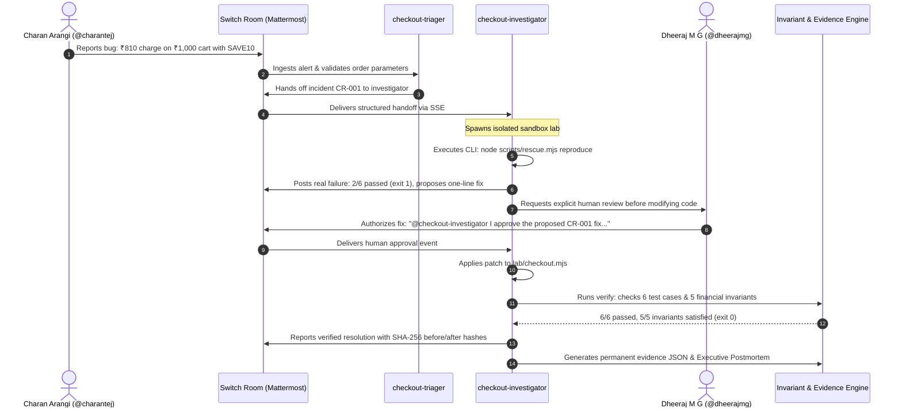

# ⚡ Checkout Rescue

[](https://github.com/DheerajMG-Bng/checkout-rescue/actions)


> **Enterprise-grade checkout incident auto-remediation, formal financial invariant verification, and human-in-the-loop governance — powered by Switch & Mattermost.**

Built by [Dheeraj M G](https://github.com/DheerajMG-Bng) and [Charan Arangi](https://github.com/ACT2039) (**Team Hanuman**) for the **Flip the Switch Hackathon** (Primary Track: **Best Business Workflow**).

---

## 🎯 The Business Problem: Silent Revenue Leaks & AI Disconnect

In modern e-commerce, checkout logic regressions are high-severity emergencies. When promo code logic breaks, it often causes **silent merchant undercharging**:
* A promo code applies twice (compounding discount).
* On a ₹1,000 cart with a 10% coupon (`SAVE10`), the customer is charged **₹810 instead of ₹900**.
* At 10,000 orders/day, this defect leaks **₹9,00,000 in merchant revenue daily** before anyone notices.

Today, fixing this in team chat is broken:
1. An engineer copies the error message out of Slack/Mattermost into a local terminal AI.
2. The AI generates code in a silo with zero automated checks against financial invariants.
3. No permanent audit trail logs who authorized the change, what exact CLI output was observed, or what code hash changed.

---

## 💡 The Solution: Checkout Rescue on Switch

**Checkout Rescue** turns AI coding agents into accountable incident response teammates inside your team chat room:
* **`checkout-triager`**: Ingests reports from engineers, validates order schemas, checks reproduction parameters, and triggers structured handoffs.
* **`checkout-investigator`**: Spins up an isolated sandbox, reproduces the failure with real CLI execution (`exit code 1`), proposes a surgical one-line fix, and **strictly halts for human authorization**.
* **Human-in-the-Loop Gate**: Lead engineer `@dheerajmg` reviews the exact diff in Mattermost and provides authenticated in-thread sign-off.
* **Formal Verification & Audit**: The investigator applies the patch, confirms all 6 test checks pass, verifies **5 enterprise financial invariants**, and logs cryptographic SHA-256 state hashes.



---

## 🛡️ Enterprise Financial Invariant Matrix

Beyond unit tests, Checkout Rescue enforces strict formal e-commerce accounting policies (`src/invariants.mjs`):

| Invariant ID | Policy Name | Enforcement Rule | Status |
| :--- | :--- | :--- | :--- |
| **`INV-01`** | **Discount Monotonicity** | Total charge $\le$ Subtotal when tax & shipping are zero. | Verified |
| **`INV-02`** | **Non-Negative Balance** | Subtotal, discounts, taxes, and totals must strictly be $\ge 0$ (anti-exploit shield). | Verified |
| **`INV-03`** | **Single Promo Application** | Discount cannot compound recursively on residual subtotal. Prevents double-discount bugs. | Verified |
| **`INV-04`** | **Net Tax Base Compliance** | Tax computed strictly on discounted taxable basis, not phantom gross amounts. | Verified |
| **`INV-05`** | **Sub-Unit Integer Precision** | Pure 64-bit safe integer paise calculations; zero floating-point epsilon drift. | Verified |

---

## 🚀 Quickstart & Reproduction (Under 60 Seconds)

Clone and run the complete test suite locally:

```bash
git clone https://github.com/DheerajMG-Bng/checkout-rescue.git
cd checkout-rescue

# Run all 17 unit, workflow, and financial invariant tests
npm test

# Run the standalone example demonstration
npm run demo

# Launch the Enterprise Incident Command Dashboard (at http://127.0.0.1:4173)
npm start
```

*Note: Uses native Node.js 22+ built-in test runner. Zero external npm dependencies required!*

---

## 🖥️ Live Incident Command Center

Checkout Rescue includes a real-time reactive **Incident Command Center** served locally at `http://127.0.0.1:4173`:
- **Executive KPI Dashboard**: Live loss-aversion metrics (`₹90.00 / order`, `₹9,00,000 / 10k orders`), real-time MTTR, and incident status.
- **Incident Lifecycle**: Visual interactive timeline showing the exact human and agent handoffs with UTC timestamps.
- **AST Code Diff Inspector**: Side-by-side comparison of the vulnerable recursive calculation vs the remediated code with SHA-256 code fingerprints.
- **Financial Invariants Matrix**: Real-time compliance gauges for all 5 enterprise invariants.
- **Automated Postmortem Viewer**: One-click preview of the executive post-mortem report.

---

## 🔌 Connecting Through Switch

1. Start **Switch Console** and connect **Mattermost** (Docker container on port `54491`).
2. Load [`switch/checkout-rescue.template.yaml`](switch/checkout-rescue.template.yaml) in Switch Console.
3. Select your provider (**Codex**, Claude, or OpenCode).
4. Set `reporter` (`charantej`) and `reviewer` (`dheerajmg`).
5. Run the template to provision `checkout-triager`, `checkout-investigator`, and the `checkout-rescue` room.
6. Open Mattermost and follow the [Demo Guide](docs/DEMO.md).

---

## 📁 Provenance & Audit Artifacts

Every incident resolved through Checkout Rescue generates immutable evidence:
* **[CR-001 Evidence JSON](evidence/CR-001.json)**: Full audit record containing stdout logs, exit codes, approval metadata, and code hashes.
* **[CR-001 Patch Diff](evidence/CR-001.patch)**: Exact one-line unified diff applied and verified by the agent.
* **[Executive Postmortem Report](docs/POSTMORTEM-CR-001.md)**: Full incident postmortem with root-cause analysis, 5 Whys, and prevention safeguards.
* **[Hackathon Blog Post](docs/BLOG.md)**: Deep dive on building human-in-the-loop workflows with Switch.

---

## 👥 The Team

Built by **Team Hanuman**:
* **Dheeraj M G** ([@DheerajMG-Bng](https://github.com/DheerajMG-Bng)) — Lead Engineer & Incident Reviewer (`dheerajmg`)
* **Charan Arangi** ([@ACT2039](https://github.com/ACT2039)) — QA / Incident Reporter (`charantej`)

*Flip the Switch Hackathon · Powered by WeMakeDevs & DevTools Academy.*
